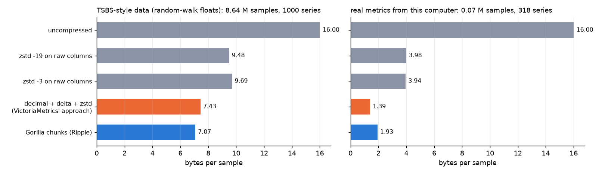
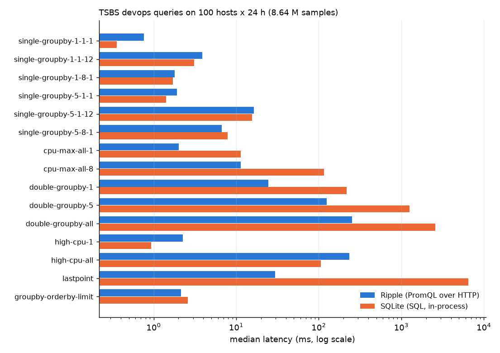

# Ripple

A time-series database written from scratch, with a metrics agent, a load generator and a dashboard.

- **Rust (`engine/`)**: the storage engine and server.
  - Gorilla-compressed chunks: delta-of-delta timestamps, XOR-encoded values.
  - A write-ahead log with checksummed records.
  - Immutable on-disk blocks with an inverted label index, merged by compaction.
  - A subset of PromQL, behind the Prometheus HTTP query API.
- **Go (`agent/`)**: an agent that collects this machine's CPU, memory, disk and network counters. It also scrapes any Prometheus text endpoint and pushes everything to Ripple. While Ripple is unreachable it keeps the batches queued.
- **Python (`eval/`)**: the evaluation.
  - A load generator following the Time Series Benchmark Suite's "devops" use case.
  - Comparisons with SQLite and with other encodings on the same data.
  - A crash-recovery test.
- **TypeScript (`web/`)**: dashboards for this computer and for Ripple itself, a query console, and a storage overview.



## Results

The data comes from two sources:
- **TSBS-style**: 100 hosts × 10 CPU fields, one reading every 10 s for 24 hours. That is 1,000 series and 8.64 M samples, generated by `ripple_eval.tsbs` (TSBS's own code is not used; see [Data](#data)).
- **Real**: 318 series (70,230 samples) from this computer and from Ripple's and the agent's own metrics, collected every 15 s by the agent.

Machine: Windows 11, NVMe SSD. Every number below comes from the scripts in `eval/`, and the raw output is in `results/`.

### Bytes per sample

`ripple codecs` encodes the same samples several ways, then decodes each one and checks every value bit for bit.

| Encoding | TSBS-style data | Real metrics |
|---|---|---|
| **Gorilla chunks (Ripple's format, 120 samples per chunk)** | **7.07** | **1.93** |
| Decimal conversion, then delta, then zstd (the approach VictoriaMetrics describes, re-implemented here) | 7.43 | **1.39** |
| zstd level 3 on the raw columns | 9.69 | 3.94 |
| zstd level 19 on the raw columns | 9.48 | 3.98 |
| Uncompressed (8-byte time + 8-byte value) | 16 | 16 |

On disk, a Ripple block of the TSBS data (chunks plus index) takes **7.26 bytes/sample**. SQLite takes **25.6 bytes/sample** (table `(series_id, ts, value)` with a primary key, WITHOUT ROWID).

What the numbers show:
- **TSBS-style values are close to incompressible.** TSBS's CPU readings are random walks with full-precision float steps, so about 50 bits of every value are effectively random, and no encoding gets far below 7 bytes. Only 12 of the 2,000 blocks could be stored as exact decimals: those are walks pinned at 0 or 100.
- **Real metrics are where the encodings separate.** Many series are constant or integer counters, and timestamps carry scrape jitter.
  - Gorilla gets 1.93 bytes/sample.
  - Decimal conversion turns counters into small integer deltas, and zstd then removes repetition across the whole block (8,192 samples), so it gets 1.39, 28% smaller.
  - Speed is mixed:
    - the decimal path decoded faster here, at 35–47 M samples/s against 23–39 M for Gorilla;
    - Gorilla encoded real metrics four times faster, at 39 M against 10 M samples/s.
  - The structural difference is that Gorilla appends one sample at a time to an open chunk, while the decimal approach needs a whole block before it can compress.
- Both approaches beat general-purpose compression of the raw columns by a wide margin.

**Published figures**, not measured here and on different data:

| System | Bytes/sample | Source |
|---|---|---|
| Gorilla | 1.37 per data point | Facebook production data (Pelkonen et al., VLDB 2015) |
| Prometheus | 1–2 per sample | its storage documentation's planning estimate |
| VictoriaMetrics | about 0.3, vs 2.1 for Prometheus | its author's node_exporter benchmark |

Ripple's 1.93 on real metrics falls in Prometheus' range, as expected from the same chunk format. Prometheus and VictoriaMetrics themselves were not run here: the project uses no third-party binaries.

### Write throughput

All runs write the same 8.64 M samples with the WAL fsynced before each batch of 10,000 is acknowledged:

| Writer | Samples/s |
|---|---|
| `ripple load`: the engine reading the text file, parsing included | **0.78–1.11 M** (two runs) |
| `ripple load` without fsync | 1.04 M |
| Ripple over HTTP: 4 clients POSTing 10,000-line batches to `/api/v1/import/prometheus` | **0.77 M** |
| SQLite: executemany, one transaction per 10,000 rows, synchronous=FULL, values from memory (no parsing) | **0.037 M** |

Ripple writes about 20 times faster than SQLite here: it appends to the WAL and to in-memory chunks, while SQLite updates a B-tree.

Parsing was the first bottleneck. Ripple originally parsed the 12 labels of every line, which gave 0.19 M samples/s. Now it recognises a known series by its exact text, the same idea as Prometheus' scrape cache, so only new series are parsed in full.

### Query latency

The query types are TSBS's 15 "devops" queries, written in PromQL for Ripple (over HTTP, including JSON encoding) and in SQL for SQLite (in-process). Each value below is the median of 20 runs with random hosts and time windows.

The first run of every query type is cross-checked: **Ripple's answer equals SQLite's for all 15 types**, point for point.

| Query | What it asks | Ripple | SQLite |
|---|---|---|---|
| single-groupby-1-1-1 | max of 1 field, 1 host, per minute, 1 h | 0.8 ms | 0.4 ms |
| single-groupby-1-1-12 | same over 12 h | 3.9 ms | 3.1 ms |
| single-groupby-1-8-1 | 1 field, 8 hosts, 1 h | 1.8 ms | 1.7 ms |
| single-groupby-5-1-1 | 5 fields, 1 host, 1 h | 1.9 ms | 1.4 ms |
| single-groupby-5-1-12 | 5 fields, 1 host, 12 h | 16 ms | 16 ms |
| single-groupby-5-8-1 | 5 fields, 8 hosts, 1 h | 6.7 ms | 7.9 ms |
| cpu-max-all-1 | all 10 fields, 1 host, per hour, 8 h | 2.0 ms | 11 ms |
| cpu-max-all-8 | all 10 fields, 8 hosts, 8 h | 11 ms | 116 ms |
| double-groupby-1 | mean of 1 field per host per hour, all hosts, 12 h | 25 ms | 216 ms |
| double-groupby-5 | same for 5 fields | 124 ms | 1,262 ms |
| double-groupby-all | same for all 10 fields (4.3 M samples) | 253 ms | 2,572 ms |
| high-cpu-1 | readings above 90 %, 1 host, 12 h | 2.3 ms | 0.9 ms |
| high-cpu-all | readings above 90 %, all hosts, 12 h | 235 ms | 106 ms |
| lastpoint | the latest reading of every series | 29 ms | 6,493 ms |
| groupby-orderby-limit | max per minute across all hosts, 5 minutes | 2.1 ms | 2.6 ms |



Ripple is about 10 times faster on queries that aggregate many series over hours, because it decodes compressed chunks sequentially while SQLite walks its B-tree row by row. On `lastpoint` it is 220 times faster: SQLite runs one correlated subquery per series.

SQLite wins in two cases:
- **Tiny queries** (under 1 ms): Ripple's figure includes an HTTP round trip.
- **The `high-cpu` filters**: SQLite filters rows with an index. Ripple evaluates a range query at every 10 s step, which is how PromQL defines it, and returns every step that passes the filter.

`high-cpu-all` was 852 ms before label sets became shared (reference-counted) instead of copied at every step.

### Recovery after a forced stop

`python -m ripple_eval.crash` stresses a server set up so that maintenance happens constantly:
- the server uses 10-minute blocks, and simulated time advances 50 s per batch, so head cuts, WAL checkpoints and compactions run all the time;
- a writer posts 1,000-sample batches;
- after 0.3–2.5 s the server is hard-killed (TerminateProcess), restarted, and all of its data is read back.

Over 30 rounds:

| Measure | Result |
|---|---|
| Samples acknowledged (HTTP 204) | 8,013,000 |
| Acknowledged samples lost | **0** |
| Samples present that were never acknowledged, other than a batch in flight | **0** |
| Duplicates | **0** |
| Batch in flight at the kill | always all present or all absent (14 present, 16 absent) |
| Restart time | 0.5 s median, 1.0 s max (up to 288 blocks) |

This test also found a real problem:
- A head cut wrote one block per pass and rewrote the WAL after each block, and it held the append lock while writing the blocks.
- With data far behind (simulated hours in seconds), writers stalled long enough that 15 of the 30 rounds acknowledged nothing.
- Now:
  - one pass cuts every complete range, with a single checkpoint;
  - the cut first raises the minimum accepted timestamp, which freezes the data below the boundary;
  - it then writes the blocks without blocking appends.

CI later found a second defect on Linux: a kill during the deletion of compacted blocks could leave a half-deleted block directory, which stopped the next start. Blocks are now renamed to `<id>.deleted` (an atomic step) before they are removed, and leftovers are cleaned up on open.

A process kill tests crash consistency: torn records, interrupted block writes and compactions. It cannot test power loss. Data that was not yet fsynced would then be lost from the OS cache, and the fsync before each acknowledgement exists for that case.

A kill never left a torn WAL record in these runs (the OS keeps whatever the process had written). Torn and corrupted records are covered by unit tests: a truncated tail, and a flipped byte in the middle.

## How it works

**Chunks (`chunk.rs`)**: up to 120 samples, as in Prometheus.
- Timestamps:
  - the first is a varint;
  - the second is a delta;
  - after that, delta-of-deltas in buckets of 1, 2+14, 3+17, 4+20 or 4+64 bits.
- Values are XORed with the previous value. An unchanged value takes 1 bit. Otherwise only the meaningful bits are stored, reusing the previous leading/trailing-zero window when it fits.

**Write path (`storage.rs`, `wal.rs`)**:
- A batch is resolved to series. Samples that are out of order, or older than the newest block, are rejected and counted.
- The batch is written to the WAL as one checksummed record and fsynced.
- Only then is it applied to the in-memory head and acknowledged.
- The fsync runs without the head lock, so queries continue meanwhile.
- WAL replay stops at the first short or corrupt record, truncates the tail there, and drops later segments.

**Blocks**:
- When the head spans 1.5 block ranges (2 h by default), every complete range is written as a block: `chunks`, `index` (labels and chunk offsets, CRC-protected) and `meta.json`.
- Each block is written to `<id>.tmp`, fsynced and renamed.
- After that the WAL is replaced by a checkpoint of what the head still holds.
- Chunks are cut at block boundaries, so a head cut moves whole chunks without re-encoding.

**Compaction**:
- Blocks that together fill a window of 3^k ranges (6 h, 18 h, 54 h) are merged by concatenating their chunks.
- The merged block lists its parents. If a crash leaves both, the parents are deleted on open.
- Optional retention deletes old blocks.

**Index**: per block (and for the head), postings lists map label pairs to series. Equality matchers intersect them, then regex and negative matchers filter the candidates.

**PromQL (`promql.rs`)**: a lexer, a precedence-climbing parser and an evaluator.
- Supported:
  - selectors with `= != =~ !~`, ranges and `offset`;
  - arithmetic, comparisons (with `bool`), and `and`/`or`/`unless` with `on`/`ignoring`;
  - `sum avg min max count group stddev stdvar topk bottomk quantile` with `by`/`without`;
  - `rate irate increase delta idelta *_over_time quantile_over_time histogram_quantile`;
  - the math functions, `clamp*`, `time`, `vector`, `scalar`, `sort*` and `timestamp`.
- `rate` uses Prometheus' extrapolation, including counter resets and the zero-point limit. `histogram_quantile` interpolates linearly inside the bucket, as Prometheus' `bucketQuantile` does.
- Not supported: `group_left`/`group_right`, subqueries, `@`, native histograms, and string functions.

**Server (`server.rs`)**:
- Ingestion: `POST /api/v1/import/prometheus` (text format). The response is 204 after the fsync, with an `X-Ripple-Rejected` count header when samples were rejected.
- Prometheus query API: `/api/v1/query`, `/api/v1/query_range`, `/api/v1/series`, `/api/v1/labels` and `/api/v1/label/<name>/values`.
- `/api/v1/export` for raw samples, and `/api/v1/status/tsdb` for statistics.
- Ripple's own `/metrics`: write counters, head and block sizes, and latency histograms for WAL fsync and HTTP requests.
- The dashboard's static files.

**Agent (`agent/`)**:
- Every interval (15 s) it does three things:
  - it reads host counters through gopsutil, named like the node exporter's (`node_cpu_seconds_total{cpu,mode}`, `node_network_receive_bytes_total{device}` and so on);
  - it scrapes the configured targets, adding `job` and `instance`;
  - it adds its own scrape and push latency histograms.
- Every sample is stamped with the collection time.
- If a push fails, batches stay queued in order (the oldest are dropped beyond `-buffer`) and are retried on the next tick.

**Dashboard (`web/`)**:
- "This computer": CPU by mode, memory, network, disk, filesystems and processes.
- "Ripple": write rate, head series, WAL fsync p50/p99 and HTTP p99 by handler (`histogram_quantile` over Ripple's own histograms), storage and bytes per sample, and the agent's push latency.
- A query console with history.
- A storage page listing every block.

## Running it

```bash
cd engine && cargo build --release
```

```bash
cd web && npm install && npm run build
```

```bash
engine/target/release/ripple serve --data data/live --web web/dist
```

```bash
cd agent && go run . -targets ripple=http://127.0.0.1:9201/metrics
```

Then open http://127.0.0.1:9201. The evaluation:

```bash
python -m venv .venv && .venv/Scripts/pip install -r eval/requirements.txt
```

```bash
cd eval && ../.venv/Scripts/python -m ripple_eval.tsbs --hosts 100 --hours 24 --out ../data/tsbs/cpu-100x24h.prom
```

```bash
cd eval && ../.venv/Scripts/python -m ripple_eval.ingest && ../.venv/Scripts/python -m ripple_eval.queries && ../.venv/Scripts/python -m ripple_eval.crash
```

```bash
cd eval && ../.venv/Scripts/python -m ripple_eval.codecs --live-url http://127.0.0.1:9201 && ../.venv/Scripts/python -m ripple_eval.report
```

The generated file is 2 GB. `ingest` also builds the SQLite database the query benchmark uses.

### CLI

```
ripple serve  --data DIR [--addr 127.0.0.1:9201] [--web DIR] [--block-range 2h] [--retention 0] [--no-fsync]
ripple load   --data DIR [--batch 10000] [--no-fsync] FILE...     bulk load, prints throughput and size
ripple query  --data DIR QUERY [--time S | --start S --end S --step DUR]
ripple stats  --data DIR
ripple codecs FILE...                                            compare encodings on text-format samples
```

## Limitations

- **One node.** Writes are serialised through a single WAL. The HTTP ingest above uses 4 clients, but appends happen one batch at a time.
- **Blocks are read into memory** when opened (not memory-mapped). That is fine for the tens of MB here, not for terabytes.
- **Out-of-order samples are rejected**, as Prometheus does by default.
- **Range queries are evaluated step by step** on the decoded samples of every selected series. That is simple and fast enough for these queries, but filters over many steps (`high-cpu-all`) are slower than an indexed SQL scan.
- **The comparisons with Prometheus and VictoriaMetrics are indirect.** VictoriaMetrics' encoding is re-implemented from its description, and their published figures come from different data.
- **The TSBS data is generated by a re-implementation** of TSBS's devops cpu-only shape (same tags, fields, distributions and interval), not by TSBS itself. TSBS models `cpu` as a measurement with fields; here each field is a `field` label of the metric `cpu`.
- **The real-metrics sample is small**: about 70,000 samples from one computer over about an hour and a half.

## Tests

```bash
cd engine && cargo test
```

```bash
cd agent && go test ./...
```

```bash
cd eval && ../.venv/Scripts/python -m pytest -q tests
```

```bash
cd web && npm test
```

What each suite covers:
- **Rust (25 tests)**:
  - bit I/O;
  - chunk round trips with random values and timestamps;
  - text-format parsing;
  - WAL replay with a torn tail and with a corrupted byte;
  - storage: out-of-order rejection, blocks, compaction, reopening, crash leftovers, and appends running concurrently with maintenance;
  - PromQL: parsing, precedence, `rate` against hand-computed values, `histogram_quantile`, aggregations, matching, range queries;
  - the codecs.
- **Go**: parsing, labelling scraped samples, the queue during an outage, host metrics, and target parsing.
- **Python**: the generator's shape, the SQL window alignment, and a server round trip including a hard kill.
- **Web**: steps, units, legends, and series alignment.

CI runs everything on Ubuntu (and the engine on Windows too), including clippy with warnings as errors and an 8-round crash test.

## Data

- **TSBS-style load**: generated locally. The [Time Series Benchmark Suite](https://github.com/timescale/tsbs)'s devops use case was the model for the tags, the 10 CPU fields, the clamped N(0, 1) random walks, the 10 s interval and the 2016-01-01 start.
- **Real metrics**: this computer's, collected by the agent. The export is not committed, because it contains the host name.
- **Published figures**:
  - Pelkonen et al., *Gorilla: A Fast, Scalable, In-Memory Time Series Database*, VLDB 2015;
  - the Prometheus storage documentation;
  - Aliaksandr Valyala's node_exporter benchmark of Prometheus vs VictoriaMetrics.

## License

MIT
